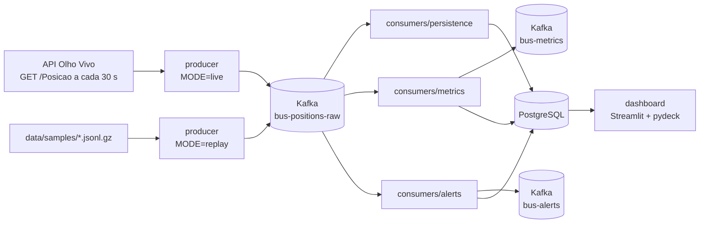
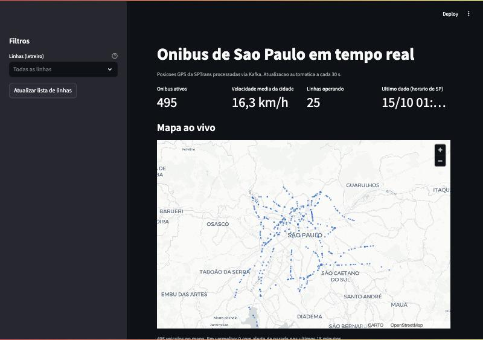

# Onibus de Sao Paulo em tempo real com Apache Kafka

Pipeline de streaming que coleta a posicao GPS dos onibus de Sao Paulo (API Olho Vivo da
SPTrans), publica os eventos no Apache Kafka, calcula metricas e alertas em tempo de
evento, grava tudo no PostgreSQL e exibe um dashboard Streamlit atualizado a cada 30 s.

## O problema e o que o projeto entrega

A SPTrans publica a cada ~30 segundos a posicao de toda a frota de onibus da cidade, mas
a API devolve apenas fotografias soltas: nao diz qual linha esta lenta, quantos onibus
estao operando agora nem qual veiculo esta parado ha muito tempo fora de um terminal.

Este projeto transforma essas fotografias em um fluxo de eventos e entrega:

- ingestao continua da API (modo `live`) ou de arquivos gravados (modo `replay`, sem token);
- um topico Kafka com uma mensagem por leitura de GPS, sem duplicatas;
- velocidade media e quantidade de veiculos por linha e sentido, em janelas de 5 minutos;
- alerta de onibus parado ha mais de 10 minutos fora de um terminal;
- historico no PostgreSQL e um dashboard com mapa, KPIs, rankings de linhas e alertas;
- tudo sobe com um comando (`make up`) via Docker Compose, inclusive em Mac Apple Silicon.

## Arquitetura



Detalhes (servicos, tabelas, views, sequencia de uma coleta, replay e garantias de
entrega) em [docs/arquitetura.md](docs/arquitetura.md).

## Stack

| Camada | Tecnologia |
|---|---|
| Linguagem | Python 3.12 nas imagens (codigo compativel com 3.11+) |
| Mensageria | Apache Kafka 3.8 em modo KRaft (imagem `apache/kafka`), cliente `confluent-kafka` |
| Observacao do Kafka | Kafka UI (`provectuslabs/kafka-ui`) |
| Banco | PostgreSQL 16 (`postgres:16.4-alpine`), driver `psycopg` 3 |
| Coleta HTTP | `requests` |
| Dashboard | Streamlit, pydeck (mapa com base Carto, sem token), pandas |
| Testes | pytest |
| Execucao | Docker Compose com healthchecks; uma imagem Python para todos os servicos |

## Como rodar (modo replay, sem token)

Pre-requisitos: Docker com Docker Compose e `make`.

```bash
make up
```

O alvo `make up` cria o `.env` a partir do `.env.example` (se ainda nao existir), faz o
build da imagem Python e sobe a stack. No modo padrao (`MODE=replay`) o producer
reproduz o sample versionado `data/samples/sample_synthetic.jsonl.gz` em loop.

O que abrir:

| Endereco | O que e |
|---|---|
| http://localhost:8501 | Dashboard |
| http://localhost:8080 | Kafka UI |
| localhost:9092 | Kafka (acesso pelo host) |
| localhost:5432 | PostgreSQL (`make psql` abre um terminal SQL) |

As portas sao publicadas apenas em `127.0.0.1` (acesso so a partir desta maquina), e o
`SPTRANS_TOKEN` so e entregue aos containers `producer` e `recorder`.

Os servicos levam alguns segundos para ficar saudaveis. As primeiras metricas aparecem
quando a primeira janela de 5 minutos (em tempo de evento) fecha; com o replay acelerado
5x isso leva no maximo pouco mais de um minuto de relogio.

Outros alvos uteis (lista completa com `make help`):

| Alvo | O que faz |
|---|---|
| `make ps` | Lista os containers e o estado de saude |
| `make logs s=producer` | Segue os logs de um servico (sem `s=`, de todos) |
| `make psql` | Abre o psql no banco do container |
| `make down` | Para e remove os containers (mantem os volumes) |
| `make clean` | Para tudo e apaga os volumes do Kafka e do PostgreSQL |
| `make replay` | Sobe a stack forcando `MODE=replay` |
| `make prune h=24` | Apaga de `bus_positions` as leituras com mais de `h` horas (relativas ao ultimo dado) |
| `make sample` | Regenera o sample sintetico |

### O que conferir no Kafka UI (http://localhost:8080)

- **Topics**: os tres topicos `bus-positions-raw` (3 particoes), `bus-metrics` e
  `bus-alerts` (1 particao cada). O contador de mensagens de `bus-positions-raw` cresce a
  cada coleta reproduzida.
- **Messages**: em `bus-positions-raw`, a chave de cada mensagem e o prefixo do veiculo
  (`vehicle_id`) e o valor e um `BusPosition` em JSON. Em `bus-metrics` a chave e
  `{line_code}-{direction}`; em `bus-alerts`, o `vehicle_id` do onibus parado.
- **Consumers**: os grupos `persistence-consumer`, `metrics-consumer` e `alerts-consumer`.
  O lag de cada grupo deve ficar proximo de zero entre uma coleta e outra; lag crescendo
  sem parar indica um consumer fora do ar ou lento.

### O que conferir no dashboard (http://localhost:8501)

- **KPIs**: onibus ativos, velocidade media da cidade, linhas operando e horario do
  ultimo dado (horario de Sao Paulo).
- **Mapa ao vivo**: ultima posicao valida de cada veiculo nos 5 minutos anteriores a
  leitura mais recente; veiculos com alerta de parada recente aparecem em vermelho.
- **Velocidade por linha (ultima janela)**: as 10 linhas mais lentas e as 10 mais rapidas
  (somente linhas com 2 ou mais veiculos).
- **Alertas recentes**: tabela de onibus parados fora de terminal.
- **Filtro por linha** na barra lateral: afeta mapa, rankings e alertas.

Com o sample sintetico, o pipeline gera exatamente 4 alertas por volta do arquivo
(veiculos 53291, 78285, 85920 e 86775) e nenhum para os veiculos parados dentro de
terminais (detalhes em [data/samples/README.md](data/samples/README.md)).

### Prints

<!--
Placeholders: as imagens ainda nao existem no repositorio.
Para gerar: rode "make up", espere alguns minutos e salve capturas de tela de
http://localhost:8501 em docs/img/dashboard.png e da pagina de consumer groups de
http://localhost:8080 em docs/img/kafka-ui.png. Depois remova este comentario.
-->




## Modo live com dados reais

### Como obter o token da SPTrans

1. Acesse a area de desenvolvedores do site da SPTrans:
   https://www.sptrans.com.br/desenvolvedores/
2. Faca o cadastro (gratuito) e entre na sua conta.
3. Crie um aplicativo para a API Olho Vivo. O site gera um token para esse aplicativo.
4. Copie o token para a variavel `SPTRANS_TOKEN` no arquivo `.env`:

```bash
make env          # cria o .env a partir do .env.example, se ainda nao existir
# edite o .env e preencha: SPTRANS_TOKEN=<seu token>
```

O `.env` esta no `.gitignore`: nunca versione o token. O producer nao o escreve nos logs.

### Rodar em live

```bash
make live
```

O producer autentica na API, chama `GET /Posicao` a cada `POLL_INTERVAL_SECONDS` (30 s),
descarta leituras repetidas e publica em `bus-positions-raw`. O alvo falha com uma
mensagem clara se `SPTRANS_TOKEN` estiver vazio.

### Gravar samples reais e reproduzi-los

```bash
make record
```

Grava `RECORD_COLLECTIONS` coletas (padrao 20, uma a cada `POLL_INTERVAL_SECONDS`) em
`data/samples/recording_<UTC>.jsonl.gz`, no mesmo formato do sample sintetico. Para
reproduzir a gravacao, ajuste o `.env` e suba a stack:

```bash
# no .env
MODE=replay
REPLAY_FILE=data/samples/recording_20261014T120000Z.jsonl.gz
```

```bash
make up
```

Gravacoes reais tem dezenas de MB (toda a frota a cada coleta) e nao devem ser
versionadas.

## Topicos Kafka e consumers

| Topico | Chave | Valor | Particoes | Produzido por | Consumido por |
|---|---|---|---|---|---|
| `bus-positions-raw` | `vehicle_id` | `BusPosition` | 3 | producer | persistence, metrics, alerts |
| `bus-metrics` | `{line_code}-{direction}` | `LineMetric` | 1 | metrics | Kafka UI / consumidores futuros |
| `bus-alerts` | `vehicle_id` | `BusAlert` | 1 | alerts | Kafka UI / consumidores futuros |

| Servico | Consumer group | O que faz |
|---|---|---|
| `persistence` | `persistence-consumer` | Grava as posicoes em lote na tabela `bus_positions` |
| `metrics` | `metrics-consumer` | Calcula janelas de 5 min por linha e sentido; publica em `bus-metrics` e grava em `line_metrics` |
| `alerts` | `alerts-consumer` | Detecta onibus parado fora de terminal; publica em `bus-alerts` e grava em `bus_alerts` |

Formato resumido dos eventos (JSON UTF-8, datas ISO 8601 UTC com sufixo `Z`):

- `BusPosition`: `vehicle_id`, `line_code`, `line_sign`, `direction`, `destination_sign`,
  `origin_sign`, `accessible`, `lat`, `lon`, `event_ts` (horario do GPS), `collected_at`,
  `reference_time`, `source` (`live` ou `replay`), `schema_version`.
- `LineMetric`: `window_start`, `window_end`, `line_code`, `line_sign`, `direction`,
  `avg_speed_kmh`, `speed_samples`, `active_vehicles`, `accessible_vehicles`,
  `accessible_pct`, `computed_at`, `schema_version`.
- `BusAlert`: `alert_id` (deterministico), `alert_type` (`STOPPED_VEHICLE`),
  `vehicle_id`, linha, sentido, `lat`, `lon`, `stopped_since`, `detected_at`,
  `stopped_minutes`, `last_speed_kmh`, `schema_version`.

Exemplos completos, tabelas e variaveis de ambiente: [docs/CONTRACTS.md](docs/CONTRACTS.md).
A implementacao de referencia dos eventos esta em `common/schemas.py`.

## Regras de processamento

Todas as regras usam o **tempo de evento**: o horario em que o GPS registrou a posicao
(`event_ts`, campo `ta` da API), nunca o relogio da maquina. Assim o resultado nao muda
com atraso de entrega nem com a velocidade do replay.

- **Velocidade**: para cada veiculo guarda-se a ultima leitura valida. A velocidade e a
  distancia em linha reta (haversine) entre as duas leituras dividida pelo tempo entre
  elas. Sao descartadas: coordenadas zeradas ou fora da Grande Sao Paulo, intervalos
  menores que 1 s ou maiores que 10 min e velocidades acima de 100 km/h (salto de GPS).
- **Janelas de metricas**: janelas fixas de 5 minutos alinhadas ao relogio UTC, por linha
  e sentido. Cada janela informa veiculos ativos, percentual de veiculos acessiveis e a
  velocidade media. Uma janela fecha quando o watermark passa do fim da janela; o
  watermark e o menor entre os maiores `event_ts` de cada particao Kafka, menos 60 s de
  tolerancia, para que uma particao atrasada (por exemplo, ao consumir backlog) nao
  perca dados. Cada janela e emitida uma unica vez. Leitura que chega para
  janela ja fechada e descartada. Sem mensagens por 120 s, as janelas abertas sao
  emitidas (fim do replay). Leituras com `event_ts` mais de 5 min a frente da coleta sao
  ignoradas, para que um relogio de GPS errado nao feche janelas cedo demais.
- **Alerta de onibus parado**: uma leitura e "lenta" quando a velocidade valida e menor
  que 2 km/h e o veiculo esta a mais de 400 m de qualquer terminal conhecido. Se a
  sequencia de leituras lentas durar 10 minutos ou mais, sai um alerta. Uma leitura
  rapida ou dentro de terminal zera a sequencia; cada sequencia gera no maximo um alerta.

Todos os limites sao configuraveis no `.env` (`WINDOW_MINUTES`, `MAX_SPEED_KMH`,
`ALERT_SPEED_KMH`, `ALERT_MIN_MINUTES`, `TERMINAL_RADIUS_M` etc.).

## Decisoes tecnicas

Resumo das principais; o registro completo (D01 a D13) esta em
[docs/DECISIONS.md](docs/DECISIONS.md).

- **Tempo de evento em todo o processamento** (D01): resultados deterministicos e replay
  acelerado possivel.
- **Sample versionado sintetico** (D03): ver limitacoes abaixo.
- **Replay com rebase de timestamps** (D04): no replay, `ta` e `collected_at` sao
  deslocados para que a primeira coleta corresponda ao momento de inicio, e a cada volta
  do loop soma-se a duracao do arquivo, para nao repetir eventos. `REPLAY_SPEED=5`
  reproduz 5x mais rapido que o tempo real, entao o tempo de evento anda mais rapido que
  o relogio. Por isso as views do dashboard usam `max(event_ts)` como referencia de
  "agora", e nao `now()`. Ao reiniciar o producer, o replay continua a partir do ultimo
  `event_ts` ja publicado no topico (lido do fim de cada particao), entao o tempo de
  evento nunca volta (D12).
- **Terminais por lista estatica** (D05): a API so informa o letreiro dos terminais, sem
  coordenadas; `common/terminals.py` traz 34 terminais com coordenadas aproximadas.
- **Idempotencia no banco** (D07): `UNIQUE (vehicle_id, event_ts)` com
  `ON CONFLICT DO NOTHING`, upsert de metricas por janela e `alert_id` deterministico.
  O offset so e commitado depois da escrita, entao reprocessar nao duplica linhas
  (at-least-once com efeito idempotente). Os consumers de metricas e alertas gravam no
  banco antes de publicar no Kafka; em falha, os topicos `bus-metrics` e `bus-alerts`
  podem ter mensagens repetidas, que um consumidor deve deduplicar pela chave/`alert_id`.
- **Producer sem duplicatas**: descarta a leitura cujo `event_ts` e igual ou anterior ao
  ultimo publicado para o mesmo veiculo (repetida ou fora de ordem).
- **Robustez a mensagens invalidas** (D12): uma mensagem malformada e registrada e
  ignorada (com offset commitado); nunca derruba um consumer.
- **Estado em memoria** nos consumers de metricas e alertas (D08), por simplicidade.
- **Uma imagem Python para todos os servicos** (D06) e um loop de processamento
  compartilhado em `common/stream_loop.py` (D10).

## Limitacoes

- **Sample sintetico** (D03): durante a construcao nao havia token da SPTrans, entao o
  arquivo versionado foi gerado por `producer/synthetic.py`, no formato exato da resposta
  de `/Posicao`, com onibus em trajetos entre terminais reais. Ele planta de proposito os
  casos de borda (paradas fora e dentro de terminal, coordenadas zeradas, duplicatas,
  saltos de GPS). Os numeros vistos no dashboard em replay nao representam a cidade real;
  para isso use `make record` e `REPLAY_FILE`.
- **Precisao do GPS**: as coordenadas tem erro de alguns metros e eventuais saltos. A
  velocidade e calculada em linha reta entre duas leituras, entao subestima trajetos com
  curvas.
- **Frequencia da API (~30 s)**: a SPTrans atualiza as posicoes a cada ~30 s; nao ha
  resolucao menor que isso, e um onibus parado so e percebido apos algumas coletas.
- **Terminais aproximados** (D05): coordenadas aproximadas e raio fixo de 400 m.
  Garagens e pontos finais que nao estao na lista podem gerar alertas falsos.
- **Estado em memoria** (D08): ao reiniciar o consumer de metricas ou de alertas, a
  janela em andamento pode sair incompleta e uma parada em curso recomeca a contagem;
  uma parada que ja tinha alertado pode gerar um segundo alerta (D13).
- **Uma instancia do consumer de metricas** (D13): as mensagens sao particionadas por
  veiculo, entao duas instancias calculariam janelas parciais da mesma linha.
- **Retencao de dados**: o Kafka guarda mensagens por 24 h (`KAFKA_LOG_RETENTION_HOURS` no
  `docker-compose.yml`),
  mas a tabela `bus_positions` cresce sem limpeza automatica. Em live, com toda a frota a
  cada 30 s, isso vira milhoes de linhas por dia. Use `make prune h=24` para apagar
  leituras antigas ou `make clean` para zerar os volumes.

## Testes

```bash
make test         # testes unitarios no container (pytest -m "not e2e")
make test-local   # os mesmos testes no venv local (.venv)
make up && make e2e   # teste ponta a ponta contra a stack rodando
```

Os testes ficam em `tests/`. O marcador `e2e` separa os testes que exigem a stack Docker
no ar.

## Proximos passos

- Comparar posicoes com os horarios programados do GTFS da SPTrans (atraso por linha) e
  usar as coordenadas reais dos terminais do GTFS.
- Reescrever o processamento com Spark Structured Streaming (ou Kafka Streams/Flink),
  com estado persistente em vez de memoria.
- Schema Registry com Avro para versionar os eventos.
- Retencao e particionamento de `bus_positions` por data, com limpeza automatica.
- Alertas por linha (por exemplo, velocidade media muito abaixo do historico).

## Estrutura de pastas

```
.
├── common/              # codigo compartilhado: config, logs, schemas, geo, tracker,
│                        # terminais, kafka_utils, db, runtime, stream_loop, timeutils
├── producer/            # coleta live, replay, gravador (record) e gerador sintetico
├── consumers/
│   ├── persistence/     # bus-positions-raw -> bus_positions
│   ├── metrics/         # janelas de 5 min -> bus-metrics + line_metrics
│   └── alerts/          # onibus parado -> bus-alerts + bus_alerts
├── dashboard/           # app Streamlit (app.py) e consultas as views (queries.py)
├── sql/                 # schema, indices e views (aplicados na criacao do Postgres)
├── docker/              # Dockerfile Python unico e script de criacao dos topicos
├── data/samples/        # sample sintetico versionado e gravacoes locais
├── tests/               # testes unitarios e ponta a ponta (pytest)
├── docs/                # contratos, decisoes, arquitetura e prints (img/)
├── docker-compose.yml
├── Makefile
└── .env.example
```
