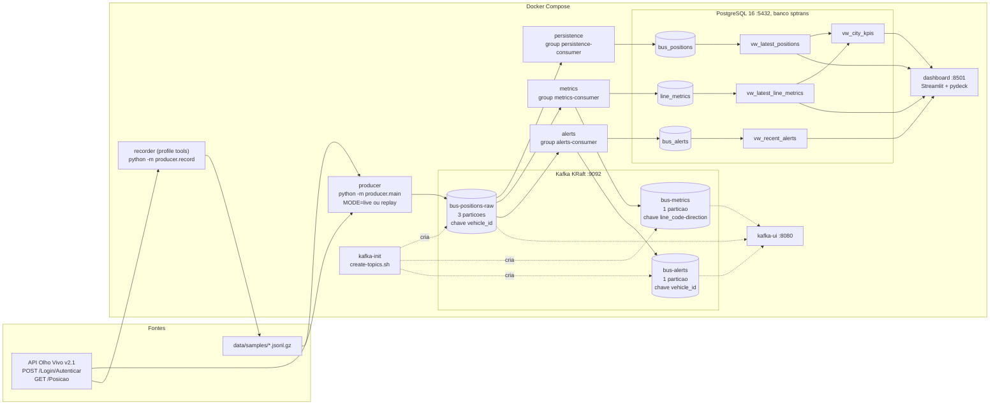
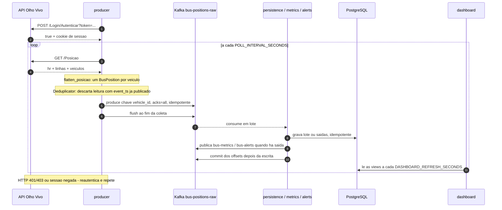
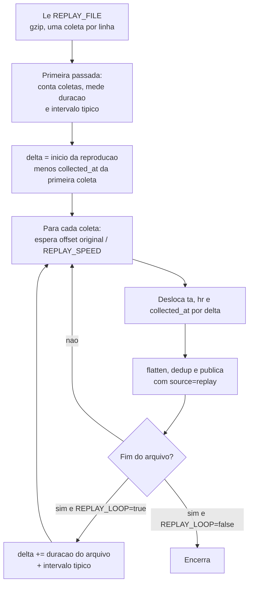

# Arquitetura

Visao detalhada do pipeline. Formatos, tabelas e variaveis sao definidos em
[CONTRACTS.md](CONTRACTS.md); o porque de cada escolha esta em [DECISIONS.md](DECISIONS.md).

## 1. Servicos, topicos, tabelas e views

| Servico | Imagem / comando | Depende de |
|---|---|---|
| kafka | `apache/kafka:3.8.1` (KRaft, broker e controller no mesmo no) | - |
| kafka-init | `docker/create-topics.sh` (idempotente, `--if-not-exists`) | kafka saudavel |
| kafka-ui | `provectuslabs/kafka-ui:v0.7.2`, porta 8080 | kafka saudavel |
| postgres | `postgres:16-alpine`, porta 5432, aplica `sql/*.sql` na criacao do volume | - |
| producer | `python -m producer.main` | kafka saudavel, kafka-init concluido |
| persistence | `python -m consumers.persistence.main` | kafka-init concluido, postgres saudavel |
| metrics | `python -m consumers.metrics.main` | kafka-init concluido, postgres saudavel |
| alerts | `python -m consumers.alerts.main` | kafka-init concluido, postgres saudavel |
| dashboard | `streamlit run dashboard/app.py`, porta 8501 | postgres saudavel |
| recorder (profile `tools`) | `python -m producer.record` (usado por `make record` e `make sample`) | - |
| tests (profile `tools`) | `pytest` (usado por `make test` e `make e2e`) | - |

Todos os servicos Python usam a mesma imagem (`docker/python.Dockerfile`, D06). Dentro da
rede do compose os servicos falam com o Kafka em `kafka:19092` e com o banco em
`postgres:5432`; pelo host, `localhost:9092` e `localhost:5432`.

As views usam `max(event_ts)` de `bus_positions` (e `max(detected_at)` em
`vw_recent_alerts`) como referencia de "agora", nunca `now()` (secao 5).

## 2. Sequencia de uma coleta (modo live)

Falhas de rede, HTTP 5xx e 429 sao repetidas com backoff exponencial e jitter
(`HTTP_MAX_RETRIES`). HTTP 401/403 ou corpo "Authorization has been denied" disparam nova
autenticacao.
Uma coleta que falha por completo e registrada no log e o loop segue para a proxima.

## 3. Fluxo do replay

- O sample versionado e sintetico (D03): gerado por `producer/synthetic.py` no formato
  exato de `/Posicao`, com casos de borda plantados. Gravacoes reais feitas com
  `make record` tem o mesmo formato e entram pelo `REPLAY_FILE`.
- Rebase (D04, `REPLAY_REBASE_TIMESTAMPS=true`): a primeira coleta passa a ter o horario
  do inicio da reproducao. Os intervalos entre leituras de um mesmo veiculo sao
  preservados, entao as velocidades continuam corretas. Como cada volta soma a duracao
  do arquivo, nenhuma leitura repete um `event_ts` ja publicado e a idempotencia do
  banco nao descarta as voltas seguintes.
- Aceleracao: com `REPLAY_SPEED=5`, 30 s entre coletas viram 6 s de relogio. O tempo de
  evento passa a andar 5x mais rapido que o relogio e fica a frente dele; por isso o
  dashboard usa `max(event_ts)` como "agora". `collected_at` e deslocado junto com `ta`,
  entao a guarda contra timestamp no futuro (D11) nao descarta as leituras do replay.

## 4. Garantias de entrega: at-least-once com idempotencia

- **Producer**: `acks=all` e `enable.idempotence=true` (`common.kafka_utils.make_producer`),
  com `flush` ao fim de cada coleta. Falhas de entrega sao contadas e registradas no log.
- **Consumers**: auto commit desligado (`enable.auto.commit=false`) e
  `auto.offset.reset=earliest`. O offset so e commitado depois que o lote foi gravado no
  banco (e, em metricas e alertas, depois que as saidas foram publicadas). Se o processo
  cair antes do commit, as mensagens sao lidas de novo: entrega at-least-once.
- **Idempotencia no banco** (D07), para que a releitura nao duplique dados:
  - `bus_positions`: `UNIQUE (vehicle_id, event_ts)` com `INSERT ... ON CONFLICT DO NOTHING`;
  - `line_metrics`: upsert pela chave `(line_code, direction, window_start)`;
  - `bus_alerts`: `alert_id` deterministico (`BusAlert.make_id`) com `ON CONFLICT DO NOTHING`.
- **Retry sem contagem dupla** (D10): em `common/stream_loop.py` cada lote e aplicado ao
  estado em memoria uma unica vez; se Kafka ou PostgreSQL falharem, somente as saidas
  pendentes sao reenviadas com backoff. Reaplicar o lote contaria velocidades duas vezes.
- **Erros por mensagem**: mensagem malformada e registrada no log e ignorada; erro de
  infraestrutura e tratado com retry e backoff. Nenhum dos dois derruba o servico.
- **Limite conhecido** (D08): o estado de processamento (ultimo ponto por veiculo,
  janelas abertas, sequencias de parada) fica em memoria. Apos um reinicio, a releitura
  desde o ultimo offset commitado reconstroi parte dele, mas a janela em andamento pode
  sair incompleta e uma parada em curso recomeca a contagem.

## 5. Tempo de evento

Todo calculo usa `event_ts` (campo `ta` da API, horario UTC da captura do GPS), nunca o
relogio da maquina (D01).

- **Velocidade**: `common.tracker.SpeedTracker` guarda a ultima leitura valida por
  veiculo; `common.geo.compute_speed_kmh` divide a distancia haversine pela diferenca de
  `event_ts`. Leituras fora de ordem (intervalo zero ou negativo) nao atualizam o estado.
- **Janelas**: tumbling de `WINDOW_MINUTES` alinhadas ao relogio UTC
  (`common.timeutils.floor_to_window`). A leitura entra na janela do seu `event_ts`.
- **Watermark**: `max(event_ts visto) - WINDOW_LATENESS_SECONDS`. Janelas com fim ate o
  watermark sao emitidas uma unica vez; leituras atrasadas para uma janela ja fechada
  sao descartadas e contadas no log. Sem mensagens por `IDLE_FLUSH_SECONDS`, todas as
  janelas abertas sao emitidas.
- **Guarda de futuro** (D11): leitura com `event_ts` mais de 5 min a frente de
  `collected_at` nao entra nas janelas, para que um relogio de GPS errado nao empurre o
  watermark.
- **Alertas**: `stopped_since` e `detected_at` sao horarios de evento; o alerta sai quando
  `event_ts - stopped_since >= ALERT_MIN_MINUTES`.
- **Consequencia**: o resultado e o mesmo em tempo real, em replay acelerado ou
  reprocessando o topico desde o inicio, e o atraso de entrega (lag) nao altera
  velocidades nem janelas. O dashboard, por sua vez, mede "recente" em relacao ao
  `max(event_ts)` gravado, o que funciona tanto em live quanto no replay acelerado.
